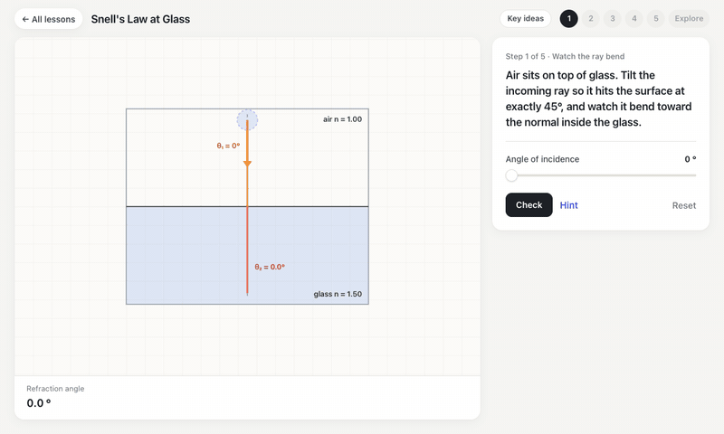
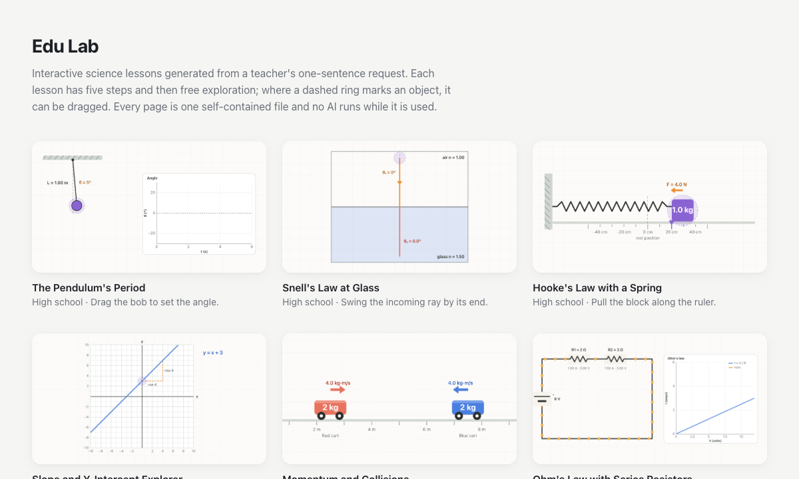
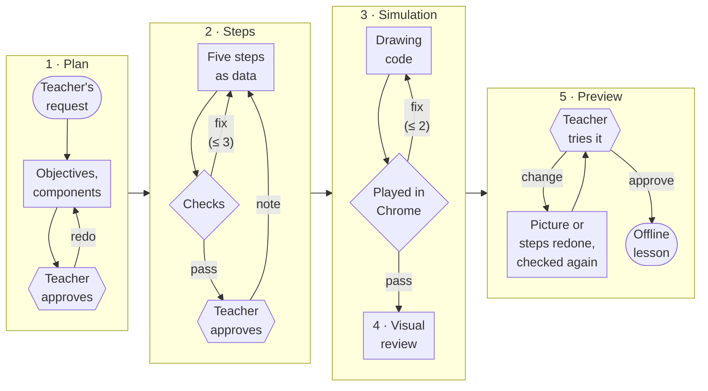

# Edu Lab

A teacher describes a science lesson in one sentence; Edu Lab generates a five-step interactive simulation,
checks it automatically in a real browser and lets the teacher review it. Students then use the lesson as one
offline HTML file, with no AI running.

**Try the lessons:** open [`docs/index.html`](docs/index.html) in a browser (six example lessons, no install).
The same folder can be served with GitHub Pages.

## How it works, in short

- The model's part is kept small so a small, cheap model is enough: it picks components from a library of 90
  tested SVG science components, writes the five steps as data (about 60 lines of JSON) and a short drawing
  function (about 30 lines). The page, the step logic and the components are fixed code.
- Every step of every lesson is played and solved in headless Chrome before the teacher sees it; errors and
  layout problems go back to the model for a fix. A vision pass then looks at screenshots of each step.
- In 53 components the student drags or clicks the object itself; the slider stays in step.
- A lesson takes about 90 seconds to generate.

## How a lesson is made

Rectangles are written by the model, diamonds are automatic checks (failures go back to the model, at most 3 or
2 times), hexagons are the teacher's decisions.

1. **Plan.** From the request (and any pasted textbook text) the model picks one or two components from the
   library and writes a title and learning objectives. The teacher edits the objectives and approves, or asks
   for a new plan.
2. **Steps.** The model writes the five steps as data: starting values, goals, questions, hints, solutions and
   short formulas. Code checks that every step starts unsolved, that its solution really solves it with the
   sliders that step allows, and that no visible number gives the answer away. Problems go back to the model
   (up to three fix rounds). The teacher approves the steps or sends a note to rewrite them.
3. **Simulation.** The model writes a short drawing function with the chosen components. Every step is played
   and solved in headless Chrome, and the layout is measured (overlapping or cut-off labels). Errors go back to
   the model (up to two fix rounds).
4. **Visual review.** The same model looks at a screenshot of each step, as a student would, and reports clear
   problems, such as a label that reveals a hidden value. One fix round is kept only if the lesson still passes
   and the review then finds fewer problems.
5. **Preview.** The teacher tries the finished lesson and approves it, or asks for a change (for the whole
   lesson or one step). The model decides whether only the picture or the steps change; the new version goes
   through the same checks and replaces the lesson only if it passes, and **Undo** goes back.

The model never writes the page, the step logic or the components: those are fixed, tested code, and model-written
expressions are checked in a locked-down process. The finished lesson runs with no AI.

Inspired by Google's "Harnessing Generative UI for Education: Tailored Learning Interactives"
(arXiv 2609.20738).

## Where things are

| Path | What |
|---|---|
| [`edu-lab/`](edu-lab/README.md) | The app: generator, checks, component library, teacher app, evaluation results |
| [`edu-lab/DESIGN.md`](edu-lab/DESIGN.md) | Design rules for the lesson page, the components and the teacher app |
| [`edu-lab/DEMO.md`](edu-lab/DEMO.md) | A four-minute demo script |
| `docs/` | Six exported example lessons (`npm run export` in `edu-lab/`) |
