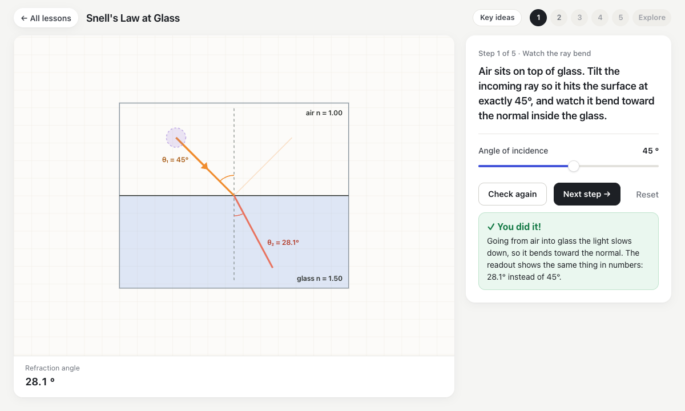

# Edu Lab

A teacher describes a science lesson (optionally pasting a textbook section); Edu Lab generates a
five-step interactive simulation, checks it automatically and lets the teacher review it. Inspired by
Google's "Harnessing Generative UI for Education: Tailored Learning Interactives" (arXiv 2609.20738).



Six example lessons are exported as static pages in [`../docs/`](../docs/index.html) (`npm run export`).

## How a lesson is generated

The model only fills in small, checked pieces; templates and examples do the rest.

| Step | Model gets | Model writes | Checked by | Teacher |
|---|---|---|---|---|
| 1. Plan | request, audience, pasted source text, one-line catalogue (`simkit/catalog.json`) | title, idea, objectives, 1–2 components | known component ids | edits/approves objectives |
| 2. Steps | plan + chosen components' API + `examples/momentum/design.json` | `design.json`: data, short JS expressions, LaTeX text, 5 levels | `checkDesign` (`server/design.ts`): expressions and LaTeX parse; each level states its whole starting situation, starts unsolved, and its solution solves it with unlocked, in-range controls; a question step's answer is not already on a visible readout; readout limits | approves or asks for changes |
| 3. Simulation | design summary + chosen components' snippets (`simkit/snippets/`) + example scene | one `scene` function (≈15–40 lines), which also links draggable objects to their sliders (`app.link`) | every level played and solved in headless Chrome; layout check (`server/layout-check.js`) | opens the lesson |
| 4. Visual review | a screenshot of the simulation at the start of each step + the step goals and hidden values (`prompts/review.md`) | up to 5 problems a student would notice | — (suggestions: one fix round, kept only if the lesson still works, has no more layout problems and a second review finds fewer problems; the fix call is limited to 45 s and little thinking, otherwise the lesson stays as built) | — |
| 5. Preview | — | — | — | tries the built lesson, then approves it or asks for changes |

**Preview and approval.** A built lesson opens as a preview with a bar above it. Only after **Approve** does it
appear in the overview. **Request changes** (for the whole lesson or one step) works on approved
lessons too. A first model call decides whether only the picture changes (the scene is redrawn and the steps
are kept) or the steps change (the design is rewritten, then the current scene is tried with it before
anything is redrawn). The new version replaces the lesson only if it passes every check and adds no layout
problems. Otherwise the lesson stays as it was and the bar says why. **Undo last change** restores the
previous version (kept in `previous/`), and a changed lesson needs approving again. Lessons made with
`generate`, `regenerate` or `eval` are approved automatically.

Each step gets up to two fix rounds with the check results sent back to the model. `assembleLesson`
turns `design.json` + `scene.js` into `lesson.js`; the model never writes the UI or the level logic.
The lesson HTML includes only the simkit files its code uses (`simkitFiles` in `server/lesson.ts`) and only the
KaTeX fonts its math uses (`katexCss`, usually 2 of 20): about 100 KB without math, about 300 KB with it.
Drafts live in `data/lessons/<id>/` with every model reply (`llm/`); the check screenshots are deleted once a lesson is ready.

- **Source text**: the teacher can paste a textbook section or notes; the plan and design steps base the
  lesson on it (`server/source.ts`, first 12k characters). The app never reads from the web.
- **Math**: text fields hold LaTeX between `$…$`; KaTeX renders it when the lesson is built
  (`server/math.ts`), so lessons need no math library at run time and stay offline.
- **Layout check**: flags overlapping labels, labels on other objects or crossed by another layer's lines
  (e.g. a duplicate ruler), overlapping components, text cut off at the edge, and title, goal or readout
  text drawn on the stage.

## Run

```sh
npm install
npm run build          # teacher app
npm start              # http://127.0.0.1:8787
npm run dev            # server + Vite with hot reload (http://localhost:5173)
```

`.env` (not committed; copy `.env.example`):

```dotenv
FIREWORKS_API_KEY=...
FIREWORKS_MODEL=accounts/fireworks/models/glm-5p3-flash
```

Command line:

```sh
npm run generate -- "Ohm's law with series resistors" --audience "High school"   # whole pipeline, no review
npm run regenerate -- <lesson-id> [--from design|build]   # redo named lessons only; backs up to data/backups/
npm run eval [-- --only id1,id2]   # eval/requests.json through the whole pipeline → data/eval/<run>/summary.md
npm run export         # the lessons in showcase.json as static pages → ../docs (free, no model calls)
npm run check [-- id…] # re-check the examples and your lessons against today's checks, in Chrome (free)
npm test               # validator, design checks, math, snippets, browser tests
npm run typecheck
```

## Layout

| Path | What |
|---|---|
| `DESIGN.md` | Design rules for the fixed parts (tokens, motion, interaction, states, drawing), taken from three design-skill repos |
| `simkit/` | SVG science components (`README.md`), the catalogue the planner picks from (`catalog.json`) and a usage example per component (`snippets/`) |
| `template/` | Fixed student UI (`shell.js`, `shell.css`, `lesson.html`), design tokens shared with the teacher app (`tokens.css`), lesson format (`CONTRACT.md`) |
| `examples/` | Reference lessons as `design.json` + `scene.js`: `momentum` is shown to the generator, `pendulum` shows direct interaction; all six are the showcase lessons `export` publishes |
| `prompts/` | Prompts for plan, steps, simulation, visual review and sorting change requests (`revise.md`) |
| `server/` | Express API (`index.ts`), pipeline (`pipeline.ts`), design checks and assembly (`design.ts`), lesson build and logic validation (`lesson.ts`), sandbox that runs model-written lesson code for those checks (`sandbox.ts`), math (`math.ts`), Chrome check (`browser-check.ts`, `layout-check.js`), card pictures (`thumbnail.ts`), Fireworks client (`llm.ts`) |
| `web/` | React teacher app |
| `scripts/` | `generate`, `regenerate`, `eval`, `export` |
| `showcase.json` | The lessons `export` publishes to `../docs/` |
| `eval/` | Evaluation requests (`requests.json`) |

**Running model-written code.** The logic checks run a lesson's expressions in a separate Node process with
the permission model on (it can read only four files, cannot write or start processes, and gets no environment
variables, so no API key) and a 5 s limit, so a broken or hostile expression cannot reach the server or hang it.
The scene itself only runs in headless Chrome. Needs Node 22.13 or later.

A lesson is one HTML file: `server/lesson.ts` inlines the shell, simkit, the lesson and (when it has
math) KaTeX's stylesheet and fonts. No AI runs while students use a lesson.

**Design.** `DESIGN.md` holds the rules; the fixed parts apply them, so every generated lesson inherits them.
Buttons respond to presses; a new step's task fades in; when the page itself changes values (step start,
Reset, "Set it up for me") the picture moves to them in 260 ms instead of jumping, while dragging and sliders
follow the pointer 1:1; solving a step is the one animated moment. Labels on the stage are drawn in darker
versions of the object colours for contrast. With reduced motion, movement is dropped (checks and screenshots
run that way).

**Student UI.** The simulation on the left (kept at its own proportions), one task card on the right:
goal → controls this step needs → Check → hints ending in a worked solution. At most 3 readouts per step,
a "Key ideas" formula sheet in the header, a clear green "✓ Correct!" box, Check stays available after
solving. The page fits the window. Five steps, then free exploration. Where a component supports it,
students drag or click the object itself (a dashed ring marks it); the slider stays in step and remains as
the keyboard and small-screen route (see "Direct interaction" in `simkit/README.md`).

**Teacher app.** Overview of picture cards (the simulation at step 1, `server/thumbnail.ts`, cached in
`data/thumbs/`) with title and audience (Middle school, High school, Undergraduate) and an audience
filter. Lessons open in the same tab with "← All lessons". New lessons go through plan → steps review and
then open as a preview to approve or change. A teacher can delete their own lessons (moved to `data/trash/`, not erased). No UI library: plain CSS on shared tokens, because each lesson must stay one offline file.

## Plan

| | Milestone | Status |
|---|---|---|
| M0 | Scaffold, archive old prototypes, `.env` | done |
| M1 | simkit (core, plot, carts, spring, circuit, gas) + template + momentum example + checks | done |
| M2 | Pipeline plan → steps → simulation with check-and-fix rounds; teacher app; redesign; LaTeX; pasted source text | done |
| M3 | Visual review of step screenshots by the vision model (GLM 5.3 Flash accepts images); evaluation on 10 requests | done |
| M4 | More components (toward 50–100 objects) and example lessons | 90 components across physics, chemistry, biology, earth science, astronomy, maths, computer science and data; second example lesson (pendulum) |
| M5 | Direct interaction: students drag and click objects on the picture, in step with the sliders | 53 of 90 components (each snippet's "Direct interaction" note says how) |

### Evaluation (`eval/requests.json`)

**Full run, 59 requests (one per topic the library covered then, plus one from pasted text), 2026-11-15.**
`eval/requests.json` has since grown to 92 requests; these numbers are from the 59-request run.
59/59 lessons built. Average 106 s per lesson (median 90 s, slowest 423 s); 21 of 59 passed every check on
the first try, the rest needed one or more fix rounds. The visual review reported 25 problems in total;
after its fix round 22 remained, spread over 20 lessons. These remaining findings have not been judged by
hand: in earlier samples about 80% of findings were real, and several in this run are known false alarms
(e.g. a floating block reported as "half submerged" when the picture is correct).

**Spot check after the design work, 3 requests (Coulomb's law, linear functions, refraction), 2026-11-15:**
3/3 built, average 84 s, no layout warnings; each scene linked its draggable objects. Before the review fix
was limited to 45 s and little thinking, one such fix call alone took 117 s (a 212 s lesson); it now takes 2–3 s.

**First 10 requests, before and after the first round of fixes:**

| Run | Ready | Avg. time | Review findings | Lessons with findings left |
|---|---|---|---|---|
| Before the evaluation fixes | 10/10 | 109 s | 20 | 7 |
| After (circuit layout switch, spring end on the ruler, min. arrow length, "always visible" notes, hidden values also on graphs, start-of-step note for the reviewer) | 10/10 | 125 s | 8 | 3 → after re-review of fixes: Hooke clean |

The reviewer is a language model: findings vary between runs and some are false (e.g. reporting the start
of a step as wrong). It is used for suggestions, never to block a lesson.

**With vs. without the review (paired test, 10 requests).** Each lesson was generated without the review
(A), then the review and its fix round were applied to the same simulation (B), and the final step
pictures were judged blind.

| Outcome | Lessons |
|---|---|
| B clearly better (newton2: wrong values and a shown answer fixed; refraction: light drawn leaving the glass as the step describes) | 2 |
| No visible difference (fix kept but nothing changed at step start) | 1 |
| Unchanged: nothing found (3) or fix rejected by the guard (4) | 7 |
| B worse | 0 |

Findings judged by hand: 11 of 14 real (~80%); all 3 false ones treat a step's starting picture as wrong.
The review costs 7–52 s per lesson (about 30 s on average). It also exposed a bug no code check caught:
an action's animation kept running into the next step and redrew the old values; the shell now stops all
animations when the step changes (`stage.stopAnimations()`).
